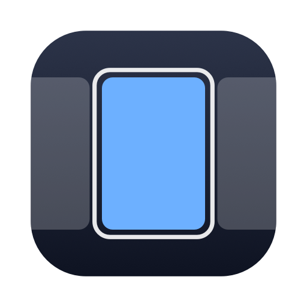

<p align="center">
  
</p>

<h1 align="center">Reel</h1>

<p align="center">A scrolling, tiling window manager for macOS.</p>

<p align="center">
  
  
</p>

Reel arranges windows as columns on a horizontal strip, one strip per display and Space, in the style of niri and
PaperWM. A new window opens as a column next to the focused one without resizing the others. When the strip is wider
than the screen, it scrolls with the keyboard or a three or four finger trackpad swipe.

It's a native AppKit app with no scripting layer to set up and no dependencies outside the system frameworks.

## Features

- Normal windows tile into columns. Dialogs, sheets, Quick Look, fixed-size windows and anything matched by a rule stay
  floating.
- Columns have preset widths (a third, a half and two thirds by default) that you cycle through, plus full width and
  free resizing with the keyboard or by dragging a window edge.
- Several windows can share a column, either stacked with adjustable heights or shown as tabs.
- A column can be pinned to the left or right edge so it stays put while the rest of the strip scrolls.
- Scrolling uses a spring animation, and the strip follows a trackpad swipe one to one with momentum.
- Each display has its own strip. Windows that reach the edge of a neighbouring display are hidden instead of spilling
  onto it.
- Native macOS tabs, minimised windows, hidden apps and full-screen windows return to their place on the strip.
- The layout survives a restart of Reel, sleep and display changes.
- Optional focus border, dimming of unfocused windows, and a strip overview at the top of the screen that can be
  clicked or dragged to reorder columns.
- Every shortcut can be rebound. Settings are a plain JSON file that reloads on save.

## Requirements

- macOS 13 Ventura or later, on Apple silicon or Intel.
- The Accessibility permission, which macOS requires for an app to move other apps' windows.

## Installation

Download `Reel.dmg` from the releases page, drag Reel to Applications and open it. The first launch walks through
granting the Accessibility permission. The Mac Setup page in the settings checks the trackpad and Spaces options that
Reel works best with, and warns if another window manager is running.

## Keyboard shortcuts

All defaults use ⌃⌥ (Control-Option). Holding ⌃⌥ for a moment shows the strip overview.

| Keys | Action |
|---|---|
| ⌃⌥ ← → or H L | Focus the column to the left or right |
| ⌃⌥ ↑ ↓ or K J | Focus the window above or below in a stacked column |
| ⌃⌥⇧ with any of the above | Move the window instead of the focus |
| ⌃⌥ 1 to 9 | Focus a column by position (⌃⌥⇧ moves the window there) |
| ⌃⌥ R | Cycle preset widths (⇧ cycles backwards) |
| ⌃⌥ F | Toggle full width |
| ⌃⌥ C | Centre the column |
| ⌃⌥ = and - | Wider and narrower (⇧ for taller and shorter in a stack) |
| ⌃⌥ 0 | Equal heights in a stack |
| ⌃⌥ [ and ] | Stack the window into the column on the left or right |
| ⌃⌥⇧ [ and ] | Take the window out of its stack, to the left or right |
| ⌃⌥⇧ T | Toggle tabs for the column |
| ⌃⌥ T | Float or tile the window |
| ⌃⌥ P | Pin the column to the left edge (⇧ for the right) |
| ⌃⌥ N | Send the window to the next display |
| ⌃⌥ , | Open settings |
| ⌃⌥ Q | Stop Reel and bring every window back on screen |

## Stacks and tabs

A column normally holds one window. To put two windows in the same column, focus one of them and press ⌃⌥ [ to move
it into the column on its left, or ⌃⌥ ] for the column on its right. The column keeps its width and splits its height
between the windows.

Inside a stack:

- ⌃⌥ ↑ and ↓ move the focus between windows, and ⌃⌥⇧ ↑ and ↓ reorder them.
- ⌃⌥⇧ = and - make the focused window taller or shorter, and ⌃⌥ 0 evens the heights out again.
- ⌃⌥⇧ T switches the column to tabs: only one window is shown at full height, with a tab bar above it. ↑ and ↓ (or
  clicking a tab) switch between them.
- ⌃⌥⇧ ] takes the focused window back out into its own column on the right, ⌃⌥⇧ [ on the left. Dragging a window out
  of a stack onto another column does the same.

## Configuration

Everything is set from the settings window (⌃⌥ ,). The same settings live in a JSON file that can be edited by hand
and is reloaded as soon as it's saved.

| File | Contents |
|---|---|
| `~/Library/Application Support/Reel/config.json` | Settings, shortcuts and window rules |
| `~/Library/Application Support/Reel/session.json` | The saved strips, restored on launch |
| `~/Library/Logs/Reel/engine.log` | Engine log |

## Scripting

Every action has a name and can be triggered from outside the app in three ways:

```sh
open -g reel://focus-right    # URL scheme
reelctl move-to-3             # command line client
reelctl status                # strips and windows as JSON
reelctl set gap 12            # change a setting
```

The Automation page in the settings links `reelctl` into `~/.local/bin` and can export Raycast script commands.
`reelctl --help` lists the actions.

## Architecture

| Module | Role |
|---|---|
| `ReelCore` | The strip model, layout maths, commands, config and the spring. Pure Swift with no AppKit, and covered by the unit tests. |
| `Reel` | The app: Accessibility and SkyLight calls, window tracking, the display-synced animator, hot keys, trackpad gestures, overlays and the SwiftUI settings. |
| `reelctl` | A small client that talks to the running app over a Unix socket. |

Window moves are sent from one background queue per app, so a slow or hung app only delays its own windows, and
intermediate animation frames are dropped rather than queued when an app can't keep up. Every Accessibility call has
a short timeout for the same reason.

## Building

Requires Xcode 15.3 or later (Swift 5.10).

```sh
swift test                      # unit tests for ReelCore
./scripts/build-app.sh          # build/Reel.app
./scripts/build-app.sh --dmg    # also build/Reel.dmg
./scripts/build-app.sh --install
```

The build script signs with the first Apple Development or Developer ID identity in the keychain, or ad hoc if there
isn't one. Signing with the same identity each time keeps the Accessibility permission across rebuilds.

### Live test

```sh
python3 scripts/live-test.py
```

This drives the installed app with four TextEdit windows and runs each action through `reelctl`. After every step it
checks that each window sits where Reel placed it, that nothing overlaps, and that scrolled-away windows are off
screen. It takes about a minute and moves real windows, so run it when you're not using the Mac.
